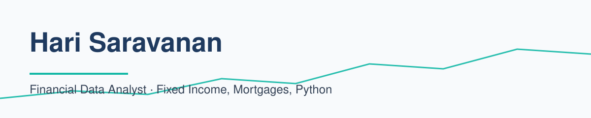
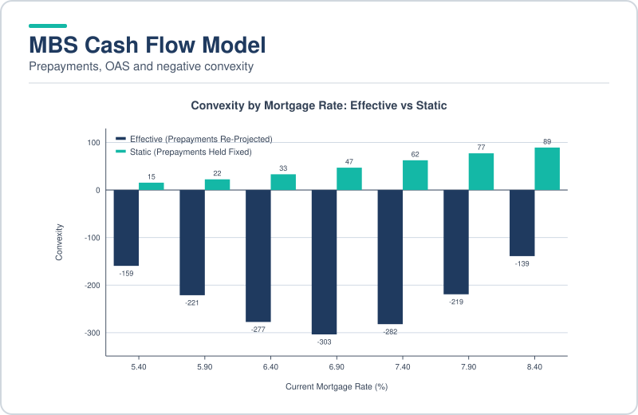
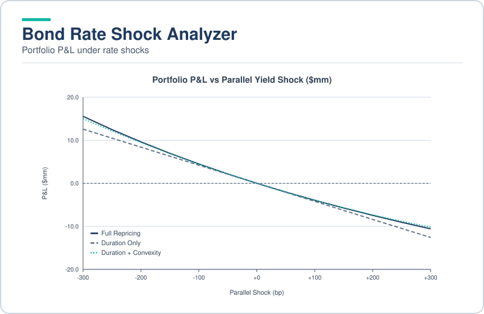
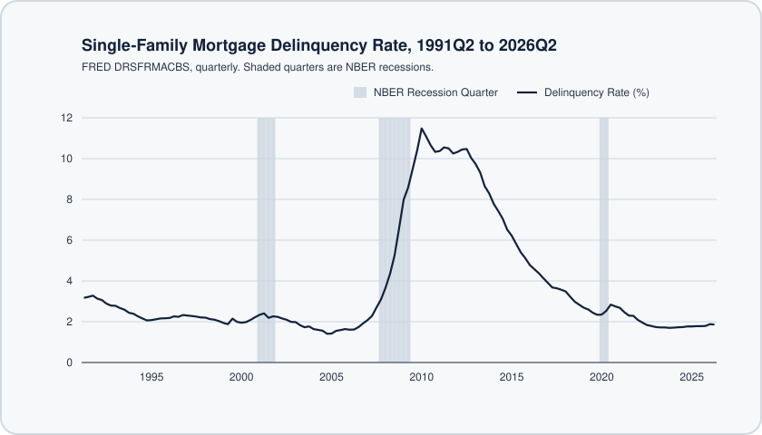
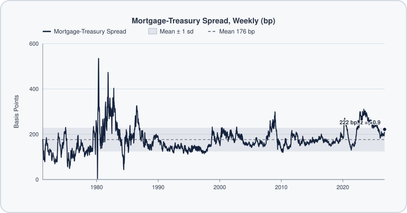
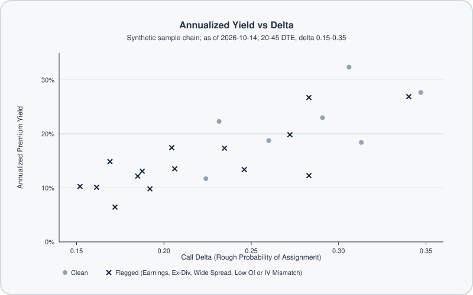
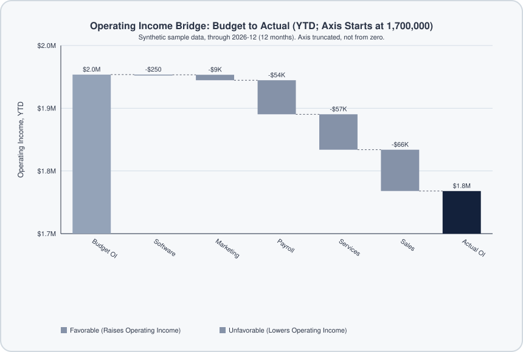

<picture>
  <source media="(prefers-color-scheme: dark)" srcset="docs/banner-dark.svg">
  
</picture>

## About

Hey, I'm Hari. I'm a financial analyst who loves technology, and lately I've been learning as much as I can about AI and Python. Here are some of the projects I've been building in my free time.

## Tech Stack

       

## Projects

<table>
<tr>
<td width="50%" valign="top">
<a href="https://github.com/builtby-hari/MBSCashFlowModel">
<picture>
  <source media="(prefers-color-scheme: dark)" srcset="docs/cards/MBSCashFlowModel-dark.svg">
  
</picture>
</a>
 Projects agency MBS cash flows with PSA and rate-linked prepayments, then measures WAL, effective duration, OAS and negative convexity.
 <b>Highlights:</b> Monte Carlo OAS · Tranche waterfall · Checked against SIFMA examples
</td>
<td width="50%" valign="top">
<a href="https://github.com/builtby-hari/BondRateShockAnalyzer">
<picture>
  <source media="(prefers-color-scheme: dark)" srcset="docs/cards/BondRateShockAnalyzer-dark.svg">
  
</picture>
</a>
 Measures portfolio P&L under parallel and key-rate shocks, compares duration and convexity estimates, and computes DV01 off a Treasury curve.
 <b>Highlights:</b> Key-rate DV01 · Duration vs convexity · Treasury par curve
</td>
</tr>
<tr>
<td width="50%" valign="top">
<a href="https://github.com/builtby-hari/MortgageDelinquencyDrivers">
<picture>
  <source media="(prefers-color-scheme: dark)" srcset="docs/cards/MortgageDelinquencyDrivers-dark.svg">
  
</picture>
</a>
 Uses OLS regressions with Newey-West standard errors to test what drives the mortgage delinquency rate.
 <b>Highlights:</b> FRED data · Regression diagnostics · Fed stress test scenarios
</td>
<td width="50%" valign="top">
<a href="https://github.com/builtby-hari/MortgageMarketDashboard">
<picture>
  <source media="(prefers-color-scheme: dark)" srcset="docs/cards/MortgageMarketDashboard-dark.svg">
  
</picture>
</a>
 Tracks mortgage rates against Treasuries, the mortgage-Treasury spread and the yield curve, using FRED data.
 <b>Highlights:</b> Spread z-score · 10Y-2Y and 10Y-3M curves · One-page Morning Note
</td>
</tr>
<tr>
<td width="50%" valign="top">
<a href="https://github.com/builtby-hari/CoveredCallScreener">
<picture>
  <source media="(prefers-color-scheme: dark)" srcset="docs/cards/CoveredCallScreener-dark.svg">
  
</picture>
</a>
 Ranks covered-call candidates from an option chain and flags the risks (synthetic data).
 <b>Highlights:</b> Assignment probability · Earnings exclusion · Roll check
</td>
<td width="50%" valign="top">
<a href="https://github.com/builtby-hari/BudgetVarianceAnalyzer">
<picture>
  <source media="(prefers-color-scheme: dark)" srcset="docs/cards/BudgetVarianceAnalyzer-dark.svg">
  
</picture>
</a>
 Compares budget to actual results, flags material variances and builds an operating income bridge (synthetic data).
 <b>Highlights:</b> Rolling forecast · Forecast accuracy · Price, volume and mix
</td>
</tr>
</table>

Every project runs on the Python standard library (matplotlib is optional), works offline from sample or cached data, and ships with tests you can run locally.

## Contact

